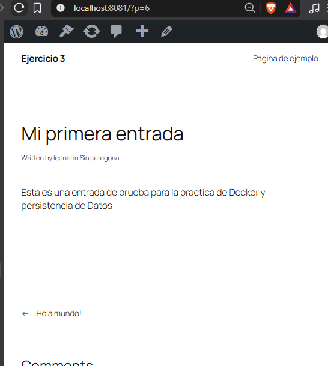

## Esquema para el ejercicio

### Crear red net-wp
 docker network create net-wp

### Para que persista la información es necesario conocer en dónde mysql almacena la información.
# COMPLETAR LA SIGUIENTE ORACIÓN. REVISAR LA DOCUMENTACIÓN DE LA IMAGEN EN https://hub.docker.com/
En el esquema del ejercicio carpeta del contenedor (a) es /var/lib/mysql

Ruta carpeta host: C:\docker\ejercicio3\db

### ¿Qué contiene la carpeta db del host?
#### Inicialmente la carpeta se encontraba vacía. Después de iniciar el contenedor MySQL contiene archivos y directorios generados por el sistema gestor de bases de datos, como mysql, sys, performance_schema y  algunos archivos de almacenamiento de InnoDB que permiten almacenar los datos de MySQL en el equipo anfitrión mediante el bind mount

### Crear un contenedor con la imagen mysql:8  en la red net-wp, configurar las variables de entorno: MYSQL_ROOT_PASSWORD, MYSQL_DATABASE, MYSQL_USER y MYSQL_PASSWORD
#### con el comando : docker run -d --name mysql-wp --network net-wp -e MYSQL_ROOT_PASSWORD=root123 -e MYSQL_DATABASE=wordpress -e MYSQL_USER=wpuser -e MYSQL_PASSWORD=wppass --mount "type=bind,source=C:\docker\ejercicio3\db,target=/var/lib/mysql" mysql:8

### ¿Qué observa en la carpeta db que se encontraba inicialmente vacía?
#### La carpeta contiene los archivos y directorios que MySQL genera para administrar y almacenar la base de datos demoestrando que el bind mount permite guardar los datos en el equipo anfitrión.

### Para que persista la información es necesario conocer en dónde wordpress almacena la información.
# COMPLETAR LA SIGUIENTE ORACIÓN. REVISAR LA DOCUMENTACIÓN DE LA IMAGEN EN https://hub.docker.com/
En el esquema del ejercicio la carpeta del contenedor (b) es /var/www/html

Ruta carpeta host: C:\docker\ejercicio3\www

### Crear un contenedor con la imagen wordpress en la red net-wp, configurar las variables de entorno WORDPRESS_DB_HOST, WORDPRESS_DB_USER, WORDPRESS_DB_PASSWORD y WORDPRESS_DB_NAME (los valores de estas variables corresponden a los del contenedor creado previamente)
#### con el comando : docker run -d --name wordpress-wp --network net-wp -p 8081:80 -e WORDPRESS_DB_HOST=mysql-wp:3306 -e WORDPRESS_DB_USER=wpuser -e WORDPRESS_DB_PASSWORD=wppass -e WORDPRESS_DB_NAME=wordpress --mount "type=bind,source=C:\docker\ejercicio3\www,target=/var/www/html" wordpress

### Personalizar la apariencia de wordpress y agregar una entrada

### Eliminar el contenedor y crearlo nuevamente, ¿qué ha sucedido?
#### Al eliminar y crear nuevamente el contenedor WordPress, la personalización y la entrada publicada se conservaron. Esto se debe a que los archivos de WordPress permanecen en la carpeta del host C:\docker\ejercicio3\www, vinculada mediante un bind mount, mientras que el contenido publicado se almacena en la base de datos MySQL, cuyos datos persisten en C:\docker\ejercicio3\db entonces al  eliminar el contenedor WordPress no provoca la pérdida de la información almacenada externamente.

